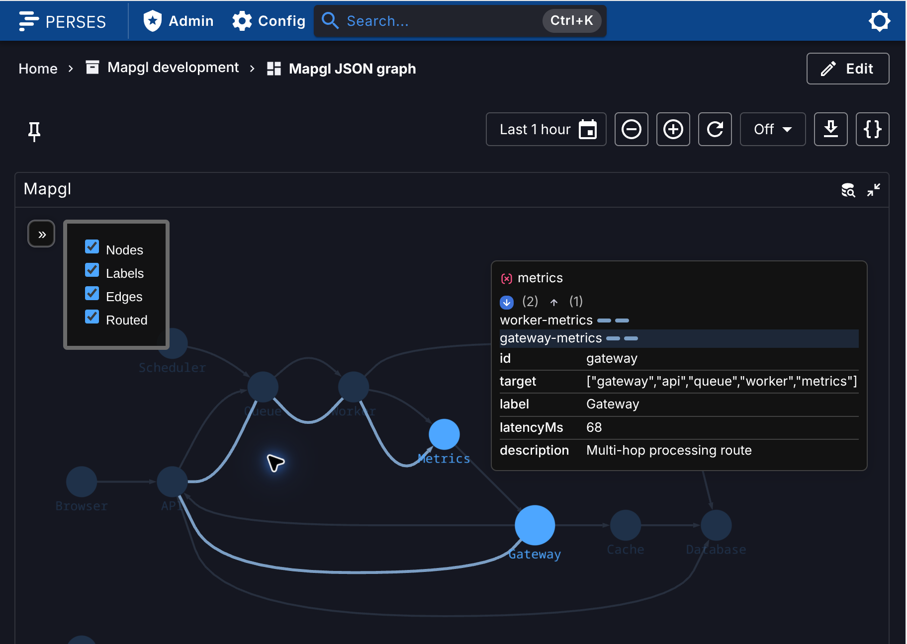

# Mapgl for Perses

Public Perses panel shell with a local `@vaduga/mapgl-perses-adapter`. The MVP displays one JSON query as an abstract node graph using the OSS Mapgl core: automatic left-to-right layout, directed edges, labels, pan/zoom, node ID/label selection immediate-neighbor highlighting and runtime display controls.



## Local source development

Keep `mapgl-perses`, `mapgl` and `mapgl-spec` as sibling checkouts. The repository `panel-core -> ../mapgl/panel-core` symlink supplies `@vaduga/mapgl-core` through the `file:./panel-core` dependency. The local `@vaduga/mapgl-perses-adapter` is an npm workspace package. TypeScript, Rsbuild and Vitest select the packages’ `development` export condition and resolve their public entry points directly from `src/`, without package-path aliases or TypeScript `paths` mappings. No core build, package archive or vendor sync is needed.

Rsbuild follows symlinks to the real checkout files so edits in both core and adapter trigger live rebuilds. It resolves dependencies from the shell’s `node_modules` first; Vitest deduplicates core dependencies and peers plus React DOM. This keeps one shared React, MobX, deck.gl and luma.gl runtime. TypeScript and Vitest preserve symlink paths for their own resolution. The source export condition is enabled for live development, tests and optimized shell builds; selecting sources does not disable production bundling optimizations. The private checkout is named `mapgl-extensions`; the Perses boundary guard rejects imports from it and from Grafana packages.

```sh
npm ci
npm run test
npm run typecheck
npm run check:boundary
npm run build
```

`npm run build` creates the federation bundle and layout worker in `dist/`; it does not package panel-core. No Grafana or private Pro packages are installed.

## Docker development

```sh
docker compose up -d --build
```

Open [the demo dashboard](http://localhost:8090/projects/mapgl/dashboards/mapgl-demo). The stack registers the Mapgl module and CUE schema, provisions a project, JSON datasource and dashboard, and serves `fixtures/graph.json` through the datasource proxy. The demo fixture has 10 nodes and 12 relationships, including branching paths, a cycle, and one multi-hop Gateway → API → Queue → Worker → Metrics edge. This logical edge has four routed hops for checking whole-edge hover and picking. Perses and Rsbuild share a container so the CLI's localhost registration is reachable by the backend. Source changes rebuild automatically; reload the dashboard to load a changed federated component.

The OSS checkout is mounted read-only at `/workspace/mapgl`. Named volumes hold installed dependencies and Perses data. A separate dependency volume under panel-core isolates npm's writes from the sibling checkout. After dependency changes:

```sh
docker compose stop dev
docker compose run --rm --no-deps dev npm ci --no-audit --no-fund
docker compose up -d --build
```

To exercise the **built** federation bundle through the same local Perses host, without creating plugin archives:

```sh
MAPGL_PERSES_BUILT=true docker compose up -d --force-recreate dev
# Return to live source rebuilding:
docker compose up -d --force-recreate dev
# Stop the stack, retaining data and installed dependencies:
docker compose down
```

Provisioning is idempotent and resets the demo dashboard to `provisioning/dashboard.json` on each dev service start. Use a separate dashboard for changes you want to retain.

Verified versions: Perses `v0.55.0-beta.4`, bundled JSON module `0.1.0-beta.2`, plugin-system `0.55.0-beta.15`, spec `0.3.0-beta.10`, React `18.3.1`, Node `22.22.2` / npm `12.2.0` in Docker. JSON queries are a beta feature and are absent from stable Perses 0.54.

## JSON graph contract

Configure exactly one `JsonQuery`. The panel reads `queryResults[0].data.data` as an array of plain JSON objects. Use the JSON datasource's JSONata expression to reshape nested API responses before they reach the panel.

```json
[
  { "id": 0, "target": "api", "label": "Browser" },
  { "id": "api", "target": "database", "label": "API" },
  { "id": "database", "target": null, "label": "Database" },
  { "id": "isolated", "target": null }
]
```

The Graph options editor exposes only `nodeIdField`, `targetField`, and optional `labelField`, defaulting to `id`, `target`, and `label`. These are literal top-level property names, including names containing dots. Required mappings must contain a non-whitespace character; CUE rejects invalid saved settings.

IDs must be strings or finite numbers; numeric zero is valid. A target can be a scalar node ID or an ordered array of at least two node IDs for one multi-hop edge, for example `["gateway", "api", "queue", "worker", "metrics"]`. Core inserts the source ID if it is omitted from the start of the path. Every hop must refer to a supplied node row. Missing, null or empty-string targets make terminal/isolated nodes. The target field must exist in at least one nonempty row so a misspelled mapping is detected. Repeated IDs support fan-out, with the core selecting the primary row for the node label. Labels must be strings when present and fall back to the normalized ID. Dangling targets produce visible core diagnostics without synthesizing nodes. Objects and invalid path elements are rejected; invalid paths produce core diagnostics.

The adapter clones and freezes accepted rows, preserves original row indexes, and assigns revisions only when query data or bindings change. It supplies the core `GraphSource` directly, without emulating Grafana DataFrames. Pan, zoom and selection do not change source revisions.

Successful empty responses clear the graph. Adapter/layout failures show an error while retaining previously committed data. Perses handles datasource loading and query errors. The viewport fits after a usable size and layout are available, preserves pan/zoom during same-topology refreshes and grid resize, and fits again when topology changes. Each mounted panel owns and disposes its controller, subscriptions and worker; obsolete layouts cannot commit.

## Neighborhood highlighting

Click a node to emphasize it, its immediate incoming/outgoing neighbors and their connecting edges/arrows. Other nodes, labels and edges dim to 18% opacity; dimmed nodes remain selectable. A background click clears selection and restores the full graph. Closing the tooltip preserves selection. Traversal stops after one hop; terminal and isolated nodes and numeric zero IDs are supported.

Hover uses the same delayed-hover hook, PointStore/GraphHighlighter and layer dimming as Grafana graph mode. Hovering any curve fragment emphasizes the whole logical edge, including every hop of a multi-hop route. Edge clicks select the logical source and focus that edge; nodes retain one-hop neighborhood selection. No custom hover shader or separate traversal implementation is used. Hover and selection do not relayout the graph, change source revisions or reset pan/zoom. A successful refresh recomputes a surviving node's neighborhood and clears focus when the selected node disappears; failed adapter/layout updates retain the last committed graph and focus. Each panel keeps its own focus state, and baseline color buffers remain unchanged.

## Graph inspection

Hover a node or connection to inspect its data; click to pin the shared panel-core tooltip. The tooltip shows the original JSON row's own fields in field order, including zero, false, null, arrays and objects. Repeated node IDs use the core primary row. Routed hops use their associated source row, while a non-routed arc inspects the whole logical connection's primary row. No internal graph properties are exposed.

Expand the incoming/down or outgoing/up controls to inspect core adjacency records. Each row identifies a connection; selecting it shows that connection's properties and pins its highlight. The original node/edge remains the list context. Hovering another graph object temporarily previews it; leaving restores the pin and selected edge highlight at the saved position. These interactions preserve layout, source revisions and camera position. Isolated nodes have no adjacency controls.

Picking another graph object preserves the chosen adjacency direction and expanded/collapsed state, matching Grafana.

The close button dismisses the tooltip while retaining the selected node or edge and its highlight. Hovering another object temporarily previews it; moving away restores the selected highlight without reopening the closed tooltip. Clicking blank canvas clears inspection and selection. Tooltip content scrolls within the panel, supports keyboard activation, and follows the Perses light/dark theme using core styles. Failed or pending data refreshes retain the displayed revision's properties; successful refreshes rebind surviving identities and clear removed selections.

## Graph display controls

Open **Graph display** at the upper left of the panel to toggle **Nodes**, **Labels**, **Edges** and **Routed** using the core LayerSwitcher. Nodes and labels are independent; Edges controls the current edge representation and its arrowheads. Routed switches between routed curves/arrows and non-routed arcs using the shared core factories. Hidden elements do not participate in canvas picking. Toggling changes rendering without relayout, pan/zoom reset, source revision changes or clearing the selected neighborhood.

Choices belong to each mounted panel and survive query refreshes, failed updates and empty responses, whether the switcher is open or closed. A dashboard reload/remount starts with all four controls enabled. These runtime controls do not add panel configuration or multiple data layers. The overlay follows the host light/dark color scheme and remains usable in narrow panels.

Geographic maps, search, multiple graph layers, field overrides and Pro editing are outside this MVP.

## Verification (2026-10-02)

44 input, viewport and core-backed lifecycle/focus/visibility tests pass, along with TypeScript, the source-boundary check and the federation build. Tests cover normalization, zero IDs, repeated rows, terminal/isolated nodes, dangling targets, labels/provenance, errors/empty data, out-of-order refreshes, invalidation, disposal and independent panel sessions. Focus tests exercise actual node/label/curve/arrow layer factories with the real layout client and MSAGL runner, plus one-hop traversal, selection switching/clearing, changed relationships, removed nodes, failed refreshes, buffer immutability and unchanged viewport/layout requests. Visibility integration tests cover the real node/label/curve/arrow gates and restoration, retained choices through tree replacement/empty/errors, failed layout and independent panel instances.

The Docker dashboard renders five nodes and three directed edges from the JSON datasource. Browser checks verified labels, worker layout, picking/clear selection, pan/zoom, grid resize, viewport preservation across a changed-label refresh, malformed-target errors, empty-result clearing and saved mappings after reload. Blank and whitespace-only required mappings were rejected by the Perses API. The static federation bundle and its hashed worker/MSAGL assets also rendered successfully. Fresh storage provisioning and service restart were checked. Live-source and built-bundle checks also verified neighborhood dimming, picking a dimmed node, clear selection and retained focus/zoom after dashboard refresh. LayerSwitcher checks in live-source and built modes verified independent Nodes/Labels controls, combined curve/arrow visibility, retained focus/zoom and open/closed refresh choices. Hidden-node picking, dark/light contrast and a narrow dashboard viewport were also checked. Docker was returned to live-source mode after verification. Selected-node relationship tests cover core counts, resolved labels, normalized zero IDs, navigation without layout/viewport changes, refresh/removal/error retention and repeated-row/self-relationship semantics. Live-browser checks verified both direction lists, neighbor navigation, expansion retention through refresh, keyboard activation, isolated-node/clear behavior and Copy ID feedback with a successful paste. Clipboard failure was not forced in the browser.

## Core refactor verification (2026-10-03)

Rebuilt against the refactored local core and replaced source/runtime aliases with conditional package exports. Moving luma.gl/deck.gl into core dependencies had created duplicate graphics runtimes and edge shader compilation errors. Rsbuild’s shell-first dependency lookup and Vitest’s runtime deduplication keep those dependencies shared without aliases. Three narrow public core exports expose `DeckWidgetButton`, `Menu/LayerSwitcher` and `Tooltips/tooltipEdgeSections` without importing the broader geographic UI barrel. Docker npm 10 repaired the lockfile's missing optional YAML peer entries, restoring clean image builds.

The Docker build, TypeScript check, source-boundary check and all 44 tests pass; every federation manifest asset exists. Resolver checks point core and adapter imports to `src/`, and timestamp-only checks confirmed live rebuilds for both source checkouts. The built plugin was browser-tested with 10 nodes/11 relationships: curves and arrowheads, node selection/highlighting, incoming/outgoing lists and neighbor navigation, edge visibility restoration, pan/zoom and refresh retention worked without browser errors. Docker was returned to live-source mode. Grafana interaction parity remains the separate follow-up described above.

## Dependency patches (2026-10-03)

Build tooling is pinned to Rsbuild `1.3.21`, the module federation Rsbuild plugin `2.9.2`, and Vitest `4.1.11`. The shell declares ESM explicitly, and the test resolver helper uses an explicit `.mjs` entry. A `fast-uri: 3.1.8` override patches the Perses plugin system’s pinned URI dependency while retaining the current Perses/JSON version family. Docker pins Node `22.22.2` and npm `12.2.0`, matching the local installer’s npm version. npm 10 and npm 12 resolve optional YAML peers differently; using npm 12 in both environments prevents a local `npm install` from invalidating the Docker lockfile.

For npm 12, `allowScripts` permits esbuild’s binary installer and denies the core-js funding banner and MapLibre’s development-only prepare script. MapLibre is outside this abstract-graph MVP. A global `.npmrc` script policy may produce a notice that the repository’s policy takes precedence; this does not block installation.

The audit now reports no high or critical findings. Three moderate entries remain for one ECharts XSS advisory inherited through `@perses-dev/components` and `@perses-dev/plugin-system`. Mapgl renders with deck.gl rather than ECharts. Removing that dependency advisory requires a compatible Perses/ECharts upgrade; do not use `npm audit fix --force` to downgrade the JSON-capable Perses setup.

## Shared planning

`openspec -> ../mapgl-spec/openspec` attaches this repository to the shared OpenSpec store. The proposal, design, specs and completed tasks are in `add-perses-node-graph-mvp`; `openspec validate add-perses-node-graph-mvp --strict` validates the change. Neighborhood highlighting is tracked in `add-perses-neighborhood-highlighting`, with its proposal, design, capability spec and completed tasks in the same store. Runtime display controls are tracked in `add-perses-layer-switcher`. Selected-node relationship controls are tracked in `add-perses-node-relationships`.

Official references: [plugin creation](https://perses.dev/perses/docs/plugins/creation/), [JSON plugin release](https://github.com/perses/plugins/releases/tag/json/v0.1.0-beta.2), [Perses beta release](https://github.com/perses/perses/releases/tag/v0.55.0-beta.4).

## Shared renderer and edition ownership

This repository contains the OSS Perses shell and public `perses-adapter`. Its product target is near-full OSS Grafana functionality excluding Geomap. The current single-query MVP and remaining relationship/settings differences are stages toward that target.

`PersesGraphSession` owns the controller, worker and `PanelRenderSession`; the shell observes the renderer through `useRenderFrame`. Standard scene capture, routed/arc geometry, mappings, node/label/arrow factories, visibility, focus and publication are core-owned. The adapter retains JSON binding, errors, semantic actions and topology/size fit policy. Cartesian extent/fit math is shared, with explicit current Perses margins and zoom ceiling. No host-specific rendering branch or duplicate orchestration loop remains.

Core tests exercise multiple layers/namespaces, repeated routes, SVG, donut/gauge inputs, bounds and private factory substitutions. These capabilities can be adopted by Perses through neutral inputs as their native settings/query contracts are implemented; they are not new MVP configuration in this change.

A future separate Pro Perses shell can pursue Grafana Pro parity by reusing this public adapter and core, and supplying private editing/path/comment/cluster and engine contributions. Private implementations belong in that future shell and private packages. This OSS repository and its public adapter do not import Pro packages or shells, and this change creates no Pro Perses repository.

## Render orchestration verification (2026-10-04)

All 48 adapter tests, TypeScript, the public dependency boundary and the Docker federation build pass against core sources. The original core curve picker and shaders are unchanged. Tests resolve every hop of the demo path through that picker and exercise the existing GraphHighlighter, with whole-logical-edge focus and no hover-triggered frame replacement or layout.

The built dashboard displays 10 nodes and 12 logical edges. Browser checks verified routed/arc switching, picking the Worker → Metrics hop of the multi-hop edge selects Gateway and dims unrelated layers, retained focus through routing changes/pan/zoom/refresh, and background selection clearing. No runtime errors occurred after refreshing the built-module registration. Docker remains in built mode. After rebuilding static assets, restart the dev service to refresh Perses's cached federation manifest. The demo query includes `fixture=multi-hop` to distinguish its revised data from the previous infinitely cached JSON query.

## Shared tooltip adoption

The `extract-host-neutral-graph-tooltip` change in the shared OpenSpec store includes Perses adoption. The shell now uses the same graph-only tooltip as the MCP and Grafana consumers, with JSON property preparation in `perses-adapter`. The former custom relationship card and neighbor-navigation presentation have been removed. The shell shares the host's Emotion context so MUI's theme mode supplies the core `dark` input; it defines no icon fallback palette.

### Verification (2026-10-23)

All 52 adapter tests, TypeScript, the public dependency boundary and the federation build pass. Tests cover original JSON property values/order, repeated-node primary rows, routed-hop/arc provenance, revision mismatches, pending/failed refresh retention, selected-edge hover restoration and clearing removed identities.

After each frontend build, the Perses dev service was restarted before browser validation. On Perses v0.55.0-beta.4, actual WebGL picking verified property rows, adjacency expansion and selection, keyboard activation, temporary hover preview and restoration of the pinned edge highlight at unchanged tooltip coordinates. Light/dark styling follows the host's shared Emotion context. Core resets inherited list margin/padding, aligning the header and direction controls; the former Copy node ID header action is removed. Fresh-service plugin-registration errors resolved after registration completed. The local demo remains in live-source mode.
